# Diagrama de clases

El diagrama recoge las 15 clases y enumeraciones propias del proyecto Java de P2A (termostato y grid), incluida la interfaz gráfica. También muestra las clases externas de JADE y Swing de las que se hereda o que intervienen en el arranque. Las flechas con triángulo indican herencia; las líneas etiquetadas muestran asociaciones y dependencias.

```mermaid
classDiagram
    direction TB

    namespace api {
        class ConexAPI {
            +getChallenges() ArrayList~Pair~
            +getStatus(runID) ResponseLAB
            +startChallenge(challengeId) ResponseLAB
            +getSensor(runID, sensorId) ResponseLAB
            +executeAction(runID, actionCode) ResponseLAB
            +closeChallenge(runID) ResponseLAB
        }
        class ResponseLAB {
            +sensorId: String
            +value: ArrayList~Pair~
            +actionId: int
            +actionStatus: String
            +reasonCodeAction: String
            +runId: int
            +runStatus: RunStatus
            +isAlive: Boolean
            +objectivePhase: String
            +remainingObjectives: int
            +reasonCode: String
            +update(jsonResponse)
        }
    }

    namespace common {
        class Pair~T,U~ {
            -first: T
            -second: U
            +getFirst() T
            +getSecond() U
            +setFirst(first)
            +setSecond(second)
            +clear()
            +equals(o) boolean
            +toString() String
        }
        class CellType {
            <<enumeration>>
            FREE
            WALL
            UNKNOWN
            GOAL
            AGENT
        }
        class Direction {
            <<enumeration>>
            NORTH
            EAST
            WEST
            SOUTH
        }
        class RunStatus {
            <<enumeration>>
            ACTIVE
            SUCCEEDED
            FAILED
            EXPIRED
            INTERRUPTED
            UNINITALIZED
        }
    }

    namespace entorno {
        class Environment {
            <<abstract>>
            #api: ConexAPI
            -instance: Environment
            +runStatus: RunStatus
            #runID: int
            #challengeID: int
            +getInstance(name)$ Environment
            +setChallenge(challengeID)
            +startChallenge()
            +checkStatus() RunStatus
            +getStatus() RunStatus
            +closeRun() RunStatus
            #resetEnvironment()
        }
        class EnvironmentGrid {
            -position: Pair~Integer,Integer~
            -directions_status: ArrayList~CellType~
            -target_pos: Pair~Integer,Integer~
            -energy_left: int
            -grid_map: ArrayList~ArrayList~CellType~~
            #resetEnvironment()
            +getPos() Pair
            +getBumpers() ArrayList~CellType~
            +getTargetPos() Pair
            +getEnergyLeft() int
            +move(dir)
            +getPosGrid(pos) Pair
            +toString() String
        }
        class EnvironmentThermo {
            -temperature: double
            -limits: Pair~Double,Double~
            -target: double
            +getMinimumLimit() double
            +getMaximumLimit() double
            +getTemperature() double
            +getTargetTemperature() double
            +activateRefrigeration()
            +disableRefrigeration()
        }
        class Main {
            +MAP_COL: int$ = 60
            +MAP_ROWS: int$ = 60
            -environment: Environment$
            -gui: GUI$
            +checkRunStatus() RunStatus$
            +getRunStatus() RunStatus$
            +printGUI(text)$
            +startChallenge(challengeID)$
            +closeRun()$
            +updateMap(map)$
            +updateInfo(info)$
            +main(args)$
        }
    }

    namespace grid {
        class AgentGrid {
            -name: String
            -direction: Direction
            +position: Pair~Integer,Integer~
            +energy: int
            -grid: EnvironmentGrid
            #setup()
            +printMessage(msg)
            +getEnvironment() EnvironmentGrid
            +getDirection() Direction
            #takeDown()
        }
        class BHGrid {
            -exitCode: int
            -grid: EnvironmentGrid
            -direction: Direction
            -distancias: ArrayList~Double~
            -casillas_adyacentes: ArrayList~Pair~
            -optima: Pair
            -indice_optima: int
            -bumpers: ArrayList~CellType~
            -active_hand: boolean
            -hand_decision: String
            -wallFollowStartDistance: int
            -last_move: Direction
            +action()
            +done() boolean
            +onEnd() int
        }
    }

    namespace termostato {
        class AgentTemp {
            -name: String
            -thermo: EnvironmentThermo
            #setup()
            +printMessage(msg)
            +getEnvironment() EnvironmentThermo
            #takeDown()
        }
        class BHThermo {
            -exitCode: int
            -thermo: EnvironmentThermo
            +action()
            +done() boolean
            +onEnd() int
        }
    }

    namespace UI {
        class GUI {
            -challengeID: int
            -mapCells: JPanel[][]
            -challengeSelector: JComboBox~String~
            -infoText: JTextArea
            -jLabel1: JLabel
            -jScrollPane1: JScrollPane
            -jScrollPane2: JScrollPane
            -mapPanel: JPanel
            -startButton: JButton
            -stopButton: JButton
            -terminalText: JTextArea
            +printText(text)
            +updateMap(data)
            +updateInfo(info)
            -initMap()
            -initComponentsCustom()
            -initComponents()
            -challengeSelectorActionPerformed(evt)
            -startButton1ActionPerformed(evt)
            -stopButtonActionPerformed(evt)
            +main(args)$
        }
    }

    namespace JADE_externo {
        class Agent {
            <<external>>
        }
        class Behaviour {
            <<external>>
        }
        class Runtime {
            <<external>>
        }
        class Profile {
            <<external>>
        }
        class AgentContainer {
            <<external>>
        }
        class AgentController {
            <<external>>
        }
    }

    namespace Swing_externo {
        class JFrame {
            <<external>>
        }
    }

    Environment <|-- EnvironmentGrid
    Environment <|-- EnvironmentThermo
    Agent <|-- AgentGrid
    Agent <|-- AgentTemp
    Behaviour <|-- BHGrid
    Behaviour <|-- BHThermo
    JFrame <|-- GUI

    Environment *-- ConexAPI : crea y conserva
    Environment ..> ResponseLAB : interpreta respuestas
    EnvironmentGrid o-- Pair : posición y objetivo
    EnvironmentGrid ..> CellType : mapa y bumpers
    EnvironmentGrid ..> Direction : acciones de movimiento
    EnvironmentThermo o-- Pair : límites térmicos
    EnvironmentThermo ..> ResponseLAB : lee sensores y acciones
    ResponseLAB o-- Pair : valores del sensor
    ResponseLAB ..> RunStatus : estado de ejecución
    ConexAPI ..> ResponseLAB : construye
    ConexAPI ..> Pair : lista de retos

    Main --> Environment : obtiene el entorno activo
    Main --> GUI : crea y actualiza
    Main ..> AgentGrid : inicia para Grid
    Main ..> AgentTemp : inicia para Thermo
    Main ..> CellType : recorta y dibuja mapa
    Main ..> Pair : coordenadas del agente
    Main ..> RunStatus : consulta estado
    Main ..> Runtime : inicia plataforma JADE
    Main ..> Profile : configura contenedor
    Main ..> AgentContainer : crea agentes
    AgentContainer ..> AgentController : crea y arranca

    GUI ..> Main : eventos y solicitudes
    GUI ..> CellType : representa celdas
    GUI ..> RunStatus : consulta estado

    AgentGrid --> Environment : obtiene singleton Grid
    AgentGrid --> EnvironmentGrid : consulta el entorno
    AgentGrid ..> BHGrid : registra comportamiento
    AgentGrid ..> Main : envía mensajes
    BHGrid --> EnvironmentGrid : percibe y mueve
    BHGrid ..> Pair : posiciones candidatas
    BHGrid ..> CellType : clasifica casillas
    BHGrid ..> Direction : decide movimientos
    BHGrid ..> RunStatus : comprueba finalización
    BHGrid ..> Main : envía mensajes

    AgentTemp --> Environment : obtiene singleton Thermo
    AgentTemp --> EnvironmentThermo : consulta el entorno
    AgentTemp ..> BHThermo : registra comportamiento
    AgentTemp ..> Main : envía mensajes
    BHThermo --> EnvironmentThermo : lee temperatura y actúa
    BHThermo ..> RunStatus : comprueba finalización
    BHThermo ..> Main : envía mensajes
```

## Lectura de las relaciones

- `Environment` es la clase base abstracta. Su fábrica singleton selecciona `EnvironmentGrid` o `EnvironmentThermo`.
- `Main` conecta la GUI con el entorno activo y crea el agente JADE correspondiente al reto.
- Cada agente obtiene el entorno compartido y registra su comportamiento (`BHGrid` o `BHThermo`), que implementa el ciclo de decisión.
- Los entornos llaman a `ConexAPI`; la API convierte las respuestas en `ResponseLAB`. `Pair`, `CellType`, `Direction` y `RunStatus` son tipos de apoyo usados por varios paquetes.
- Los elementos de los paquetes `JADE_externo` y `Swing_externo` son dependencias externas, no clases creadas en este proyecto.
