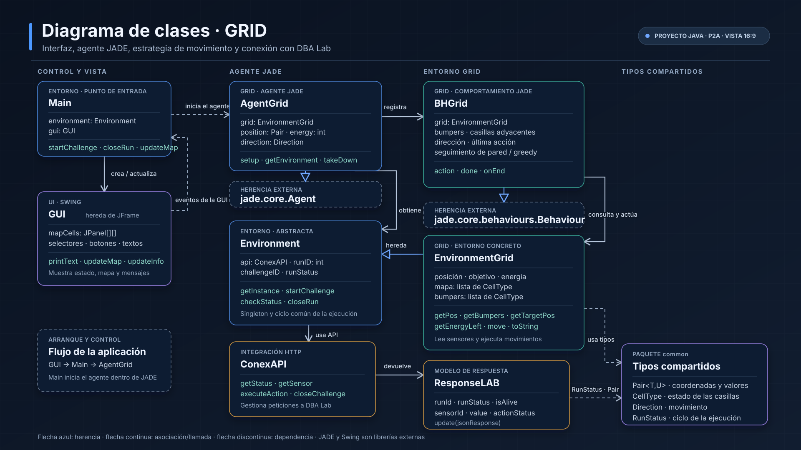

# Diagrama de clases · GRID

Vista simplificada del módulo GRID, pensada para presentarse en vídeo. La composición 16:9 prioriza el tamaño de letra y el flujo principal; muestra las clases propias de GRID, la GUI que lo controla, la jerarquía del entorno y los modelos compartidos que utiliza.

El original vectorial está en [DIAGRAMA_CLASES_GRID.svg](DIAGRAMA_CLASES_GRID.svg), para escalarlo sin pérdida al insertarlo en la edición del vídeo.

**Leyenda:** flecha azul = herencia; flecha continua = asociación o llamada; flecha discontinua = dependencia. JADE y Swing aparecen como librerías externas.
