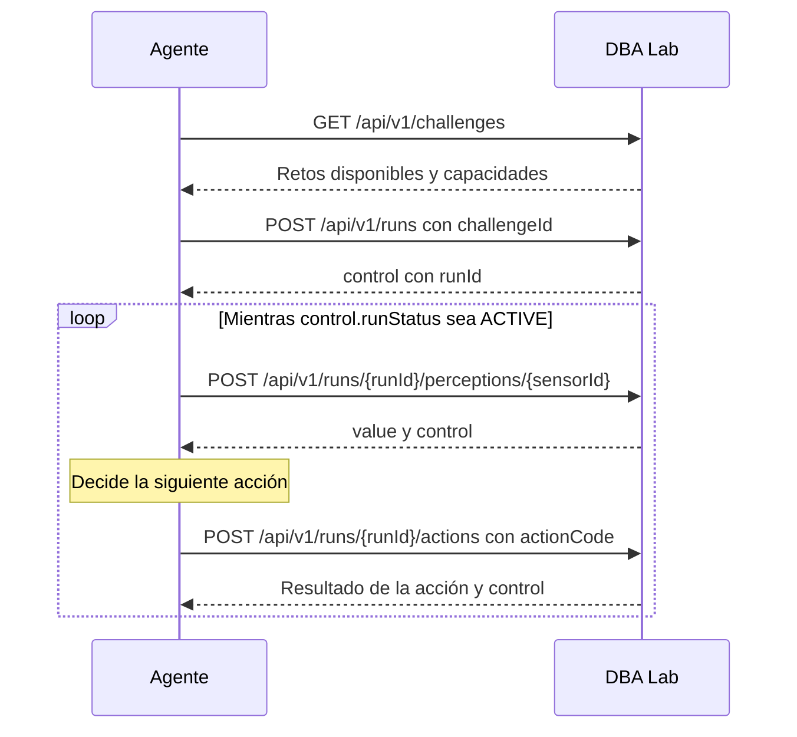

# Conexión con DBA Lab

Esta guía describe el intercambio común a los retos de termostato y Grid. Las percepciones y acciones propias de cada entorno figuran en sus guías específicas. Cada grupo decide cómo organizar el código que realiza las peticiones y cómo integra sus resultados en el agente JADE.

El acceso al servidor de DBA Lab requiere estar dentro de la red de la UGR o conectado a su VPN.

## Ciclo de una ejecución



Un reto disponible anuncia su `id`, `environmentType`, `sensorCodes` y `actionCodes`. Estos códigos se obtienen de `challenges`; no hay que fijar los identificadores numéricos en el programa. El inicio devuelve un `control.runId`, que identifica esa ejecución. Consultar un sensor no avanza el entorno. La respuesta de una acción indica si se aplicó, pero no sustituye a una nueva lectura de los sensores.

`control.runStatus` vale `ACTIVE` mientras la ejecución continúa. `SUCCEEDED`, `FAILED`, `EXPIRED` e `INTERRUPTED` indican que ha terminado. El agente debe comprobar el estado tras cada interacción y detener el envío de percepciones y acciones cuando sea terminal. `GET /api/v1/runs/{runId}` permite consultar el control sin leer un sensor.

Todas las rutas requieren `Authorization: Bearer <token>`. Las peticiones con cuerpo utilizan JSON y la cabecera `Content-Type: application/json`. Las respuestas correctas y los errores también son JSON. Un error incluye `code` y `message`; comprueba primero el código HTTP y después el contenido.

## Identidad y acceso a los runs

El token es una credencial personal: identifica a un estudiante en cada petición. No es el identificador de un `run` ni se debe compartir o transferir, tampoco entre integrantes del mismo grupo. Cada estudiante puede tener un único `run` activo; solo quien lo inició puede consultar sus datos, enviar acciones o cerrarlo. Para colaborar en grupo, cada integrante utiliza su propio token.

## Cierre e inactividad

Puedes abandonar un `run` activo mediante `POST /api/v1/runs/{runId}/close`, sin cuerpo. El laboratorio lo cierra como `INTERRUPTED` con `control.reasonCode: "STUDENT_ABANDONED"`; este cierre no cuenta como reto resuelto. Si la respuesta se pierde, consulta `GET /api/v1/runs/{runId}` antes de decidir qué hacer.

El plazo de inactividad de DBA Lab es, por defecto, de cinco minutos desde el inicio del `run` o desde la última acción física aceptada y aplicada. Solo una acción aplicada renueva ese plazo: consultar sensores o el estado, enviar una acción rechazada y esperar no lo renuevan. Al vencer, el `run` pasa a `EXPIRED` con `control.reasonCode: "INACTIVITY_TIMEOUT"`. El cierre puede constatarse al recibir una petición posterior o mediante la revisión periódica del laboratorio; no presupongas que una lectura mantiene la ejecución activa.

## Ver una petición completa con cURL

Los comandos siguientes muestran la forma de las peticiones. Sustituye los valores entre `<...>` por los obtenidos del laboratorio; las variables son solo una comodidad para escribir los ejemplos.

```sh
DBA_LAB_URL="<direccion-del-laboratorio>"
DBA_TOKEN="<token-personal>"
DBA_CHALLENGE_ID="<id-obtenido-de-challenges>"
DBA_RUN_ID="<runId-obtenido-al-iniciar>"

curl -i -H "Authorization: Bearer $DBA_TOKEN" \
  "$DBA_LAB_URL/api/v1/challenges"

curl -i -X POST -H "Authorization: Bearer $DBA_TOKEN" \
  -H "Content-Type: application/json" \
  --data "{\"challengeId\":$DBA_CHALLENGE_ID}" \  
  "$DBA_LAB_URL/api/v1/runs"

curl -i -X POST -H "Authorization: Bearer $DBA_TOKEN" \
  "$DBA_LAB_URL/api/v1/runs/$DBA_RUN_ID/perceptions/<sensorId>"

curl -i -X POST -H "Authorization: Bearer $DBA_TOKEN" \
  -H "Content-Type: application/json" \
  --data '{"actionCode":"<actionCode>"}' \
  "$DBA_LAB_URL/api/v1/runs/$DBA_RUN_ID/actions"

curl -i -H "Authorization: Bearer $DBA_TOKEN" \
  "$DBA_LAB_URL/api/v1/runs/$DBA_RUN_ID"

# Solo si quieres abandonar un run que sigue activo:
curl -i -X POST -H "Authorization: Bearer $DBA_TOKEN" \
  "$DBA_LAB_URL/api/v1/runs/$DBA_RUN_ID/close"
```

`-i` muestra el estado y las cabeceras HTTP además del cuerpo. `DBA_CHALLENGE_ID` procede del descubrimiento, y `DBA_RUN_ID` del campo `control.runId` de la respuesta de inicio. Sustituye `sensorId` y `actionCode` por capacidades anunciadas para el reto elegido.

## Hacer las mismas peticiones desde Java

Con Java 11 o posterior se puede utilizar `java.net.http.HttpClient`. Este fragmento muestra una consulta a `challenges` y el inicio de un `run`; requiere `java.net.URI` y los tipos de `java.net.http`. La elección del reto y la interpretación del JSON forman parte de vuestra solución. En el ejemplo, `DBA_CHALLENGE_ID` se establece después de consultar los retos disponibles.

```java
HttpClient http = HttpClient.newHttpClient();
String api = System.getenv("DBA_LAB_URL") + "/api/v1";
String token = System.getenv("DBA_TOKEN");

HttpRequest discovery = HttpRequest.newBuilder()
    .uri(URI.create(api + "/challenges"))
    .header("Authorization", "Bearer " + token)
    .GET()
    .build();
HttpResponse<String> found = http.send(discovery, HttpResponse.BodyHandlers.ofString());
int discoveryStatus = found.statusCode();
String discoveryJson = found.body();

long challengeId = Long.parseLong(System.getenv("DBA_CHALLENGE_ID"));
String body = "{\"challengeId\":" + challengeId + "}";
HttpRequest start = HttpRequest.newBuilder()
    .uri(URI.create(api + "/runs"))
    .header("Authorization", "Bearer " + token)
    .header("Content-Type", "application/json")
    .POST(HttpRequest.BodyPublishers.ofString(body))
    .build();
HttpResponse<String> started = http.send(start, HttpResponse.BodyHandlers.ofString());
int startStatus = started.statusCode();
String startJson = started.body();
```

El fragmento muestra la petición HTTP, no un programa completo. Antes de usar `discoveryJson` o `startJson`, comprueba el estado recibido. Extrae los identificadores y estados del JSON con el mecanismo que elijas; no bases el programa en posiciones de caracteres ni en un identificador fijo. `HttpClient.send` bloquea hasta recibir la respuesta, por lo que también debes decidir cómo integrar esa espera en el comportamiento del agente.

## Resultado de acciones y errores

`POST /api/v1/runs/{runId}/actions` recibe `{"actionCode":"..."}`. Su respuesta contiene `actionStatus`, `reasonCode` y `control`. Una acción `APPLIED` puede terminar el `run` con éxito o fracaso: consulta siempre `control.runStatus`. Una acción `REJECTED` no aplica el cambio solicitado.

Entre las respuestas de error relevantes están `401` (credencial), `404` (recurso no disponible), `409` (estado o concurrencia), `422` (capacidad no disponible) y `503` (servicio o resultado no confirmado). Los `POST` que cambian el estado no deben repetirse automáticamente si se pierde su respuesta. Si ya conoces el `runId`, puedes consultar `GET /api/v1/runs/{runId}` y `GET /api/v1/runs/{runId}/actions/last` para comprobar el estado registrado antes de decidir qué hacer.