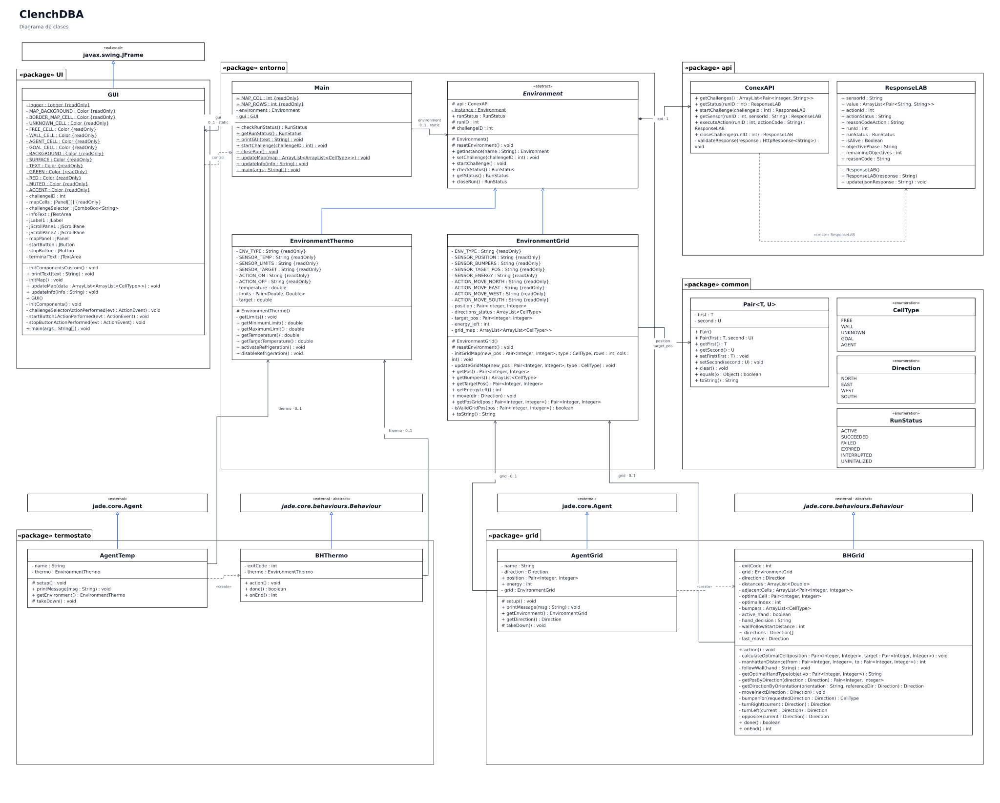

# Diagrama de clases

- [Draw.io editable](DIAGRAMA_CLASES.drawio).
- [SVG ampliable](DIAGRAMA_CLASES.svg).
- [PDF](DIAGRAMA_CLASES.pdf).

El archivo draw.io contiene el diagrama de clases y una segunda página con las relaciones entre tipos.
